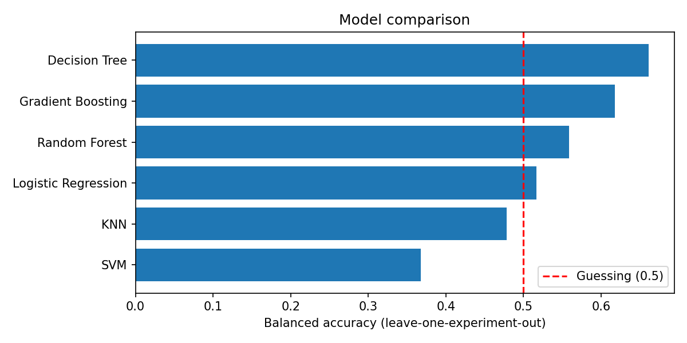
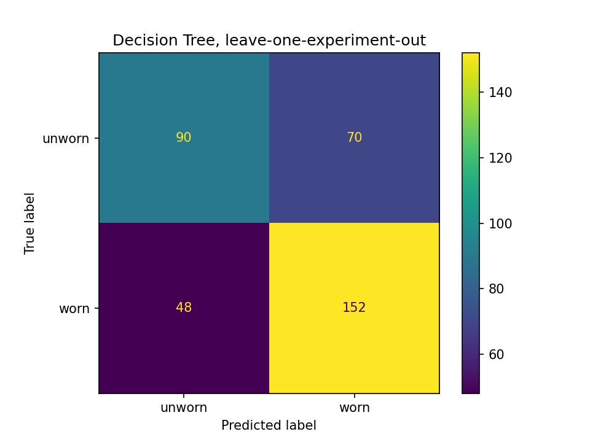

# CNC Tool Wear Classification (Worn vs Unworn)

**Author:** Jaya Singh | **Course:** BTP | **Guide:** Rajneesh Bhardwaj

## Problem
Can machine sensor data tell whether a CNC milling tool is worn or unworn?
This project trains and compares six classification models and tests them on
experiments they have never seen.

## Dataset
CNC Mill Tool Wear dataset (University of Michigan SMART Lab) from Kaggle:
https://www.kaggle.com/datasets/shasun/tool-wear-detection-in-cnc-mill

- 18 machining experiments: 10 worn, 8 unworn
- Each experiment has thousands of sensor readings (axis positions, velocities,
  accelerations, motor currents, spindle power, etc.)
- The data files are not included here. Download them from the link above.

## Method
1. Loaded all 18 experiment files and attached the worn/unworn label.
2. Removed idle rows (spindle current below 5), because they look the same for every tool.
3. Split each experiment into 20 time windows and computed mean, max, standard
   deviation and RMS for each of 45 sensors (180 features, 360 rows).
4. Trained six models: Logistic Regression, KNN, Decision Tree, Random Forest,
   SVM and Gradient Boosting.
5. Evaluated with **leave-one-experiment-out cross-validation**: each experiment
   is tested by a model trained on the other 17. A random row split would put
   near-identical windows of the same experiment in both train and test and
   inflate the scores.
6. Used **balanced accuracy** as the main metric, because 0.5 means guessing.

## Results (all features)

| Model | Balanced accuracy |
|---|---|
| Decision Tree | 0.661 |
| Gradient Boosting | 0.618 |
| Random Forest | 0.559 |
| Logistic Regression | 0.517 |
| KNN | 0.478 |
| SVM | 0.368 |

Best model (Decision Tree): caught 152 of 200 worn windows (missed 48) and
90 of 160 unworn windows (70 false alarms).

The model failed on some unworn experiments: experiments 5 and 2 were almost
always predicted as worn.

## What the model used
Both the Decision Tree and Gradient Boosting relied mainly on Z-axis position
(commanded and actual) and the Y-axis motor output current. The Y-axis current
reflects feed-drive load, so a link to cutting forces is plausible. The Z-axis
position has no obvious link to wear and may reflect differences between
experiments.

Hypothesis check: I expected worn tools to show higher spindle current. This was
not supported: mean spindle current was slightly lower for worn tools
(21.61 vs 21.86) and its variation was nearly equal (4.59 vs 4.53).
Removing position features did not improve results.

## Limitations
- Only 18 experiments, so results are suggestive and not conclusive.
- The model is only modestly better than guessing (balanced accuracy 0.66).
- Some features may identify the experiment instead of measuring wear.
- The labels are only worn/unworn, with no wear level.

## How to run
1. Download the dataset from Kaggle and upload the files to Google Colab.
2. Install the packages in `requirements.txt`.
3. Run `toolwear_classifier.ipynb` from top to bottom.